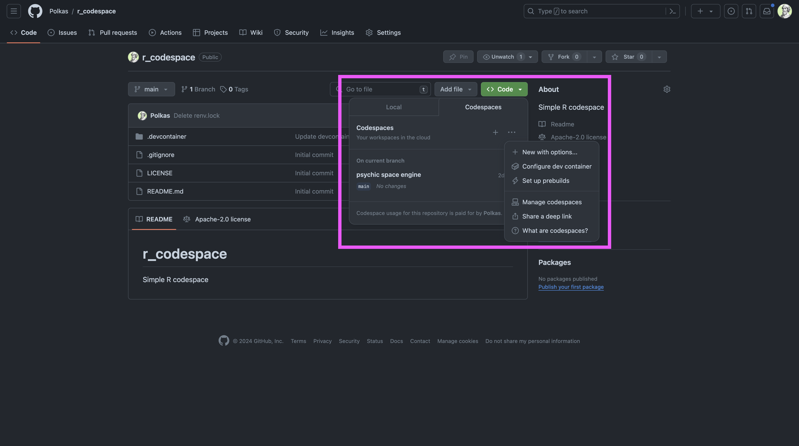

TL;DR GitHub Codespaces is a cloud-based development environment that simplifies and enhances the software development workflow. 
GitHub Codespaces provides fully configured, accessible-anywhere development environments, streamlining project setup, fostering collaboration, and ensuring consistency across teams. The default interface is built around VS Code.
The Free and Pro GitHub plans for personal accounts include free use of GitHub Codespaces up to a fixed amount of usage every month.
You can run a codespace with the Code tab in your repository.
Adding a `.devcontainer` directory with the `devcontainer.json` file allows you to customize the codespace environment and optionally add `Dockerfile` for an even more demanding setup.

 

Examples:

[Simple Codespace for R](https://github.com/polkas/r_codespace)  
[Simple Codespace for Python](https://github.com/Polkas/python_codespace)

### GitHub Codespaces in Practice

GitHub Codespaces gives a repository a ready-to-use development environment in the browser or VS Code. The main benefit is not novelty; it is removing setup friction. A new contributor can open the project and start from the same tools, dependencies and extensions as everyone else.

#### The Genesis of GitHub Codespaces

The concept behind GitHub Codespaces is straightforward yet powerful: provide developers with a fully-configured development environment that they can access from anywhere, at any time. This approach addresses common challenges in software development, such as lengthy setup times, inconsistencies across development environments, and the difficulties of collaborating on code from different locations.

#### Streamlining Development Workflows

Codespaces accelerates the development process from the get-go. Developers no longer need to spend hours configuring their development environment for each project. Instead, they can dive straight into coding, thanks to pre-configured environments that include all the necessary tools, libraries, and extensions. This immediate readiness drastically reduces setup time and allows developers to focus on what they do best: writing code.

#### Enhancing Collaboration Across Teams

Codespaces also helps teams collaborate because the environment is shared and reproducible. It is easier to review code, reproduce bugs and onboard new contributors when everyone can start from the same setup.

### Run the codespace

The Free and Pro GitHub plans for personal accounts include free use of GitHub Codespaces up to a fixed amount of usage every month.
You can quickly run a new or already existing codespace with the Code tab in your repositiory.
If you click the elipsis (...) you will find out more options.

#### `.devcontainer` Directory: A Pillar of Consistency

At the heart of Codespaces' ability to provide consistent development environments is the `.devcontainer` directory. This directory contains at least `devcontainer.json` file, which specifies the environment's configuration, and optionally, a Dockerfile for custom environment setups. Whether you're using an existing Docker image or creating a custom one, this setup ensures that every developer working on the project has an identical development environment, eliminating the "it works on my machine" syndrome.

#### Real-world Examples: Python and R Setups

To illustrate the versatility of Codespaces, let's look at examples of setting up environments for Python and R projects.

- **Python Setup**: A `devcontainer.json` for a Python project might specify a Python Docker image, install necessary packages via a `requirements.txt` file, and include essential Python development extensions. 
[Simple Codespace for Python](https://github.com/Polkas/python_codespace)
- **R Setup**: Similarly, an R project could use a `devcontainer.json` to define an R base image, install required R packages, and set up an environment tailored for R development. 
[Simple Codespace for R](https://github.com/polkas/r_codespace) and [More complex Codespace for R](https://github.com/jakubnowicki/r-codespaces/tree/main/.devcontainer)

#### Conclusion

GitHub Codespaces is revolutionizing the way developers and teams work on software projects. By providing a platform that streamlines workflow, enhances collaboration, and ensures consistency, Codespaces is a powerful tool in the arsenal of modern developers. Whether through the use of existing Docker images or the customization available with Dockerfiles, GitHub Codespaces supports a wide range of development needs, making it easier than ever to focus on creating innovative software solutions.

#### References

- [codespaces overview](https://docs.github.com/en/codespaces/overview)
- [codespaces features](https://github.com/features/codespaces)
- [simple Codespace for R](https://github.com/polkas/r_codespace)
- [simple Codespace for Python](https://github.com/Polkas/python_codespace)

## Related posts

- [Containers for Data Scientists](../containers/index.qmd)
- [Visual Studio Code: Toolkit for Data Scientists](../vscode/index.qmd)
- [GitHub Student Developer Pack: Learn to ship software like a pro](../github_pack/index.qmd)
