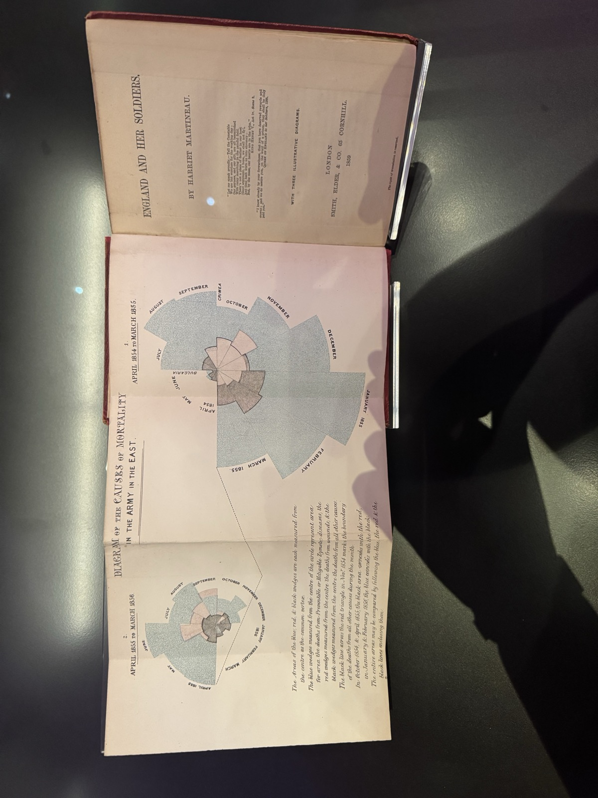

TL;DR I walked into the London Science Museum and ended up standing for ten minutes in front of a glass case containing an original 1859 copy of *England and Her Soldiers* by Harriet Martineau — open at Florence Nightingale's "Diagram of the Causes of Mortality in the Army in the East". It is one of the earliest statistical graphics drawn to win an argument. The message was uncomfortable enough that the book was banned from soldiers' barrack libraries. Below I recreate the diagram in R from the original data, so you can play with it yourself.

---

## The case I did not expect

I was in the Science Museum for the usual reasons. 
Then I turned a corner into a display of Victorian medicine and found this:

{fig-align="center" width="70%"}

The caption next to the book reads:

> **England and Her Soldiers, by Harriet Martineau, 1859**
>
> Harriet Martineau was a writer and journalist who wrote this book with Florence Nightingale, a statistician and nursing reformer. Nightingale ran British military hospitals in the 1850s Crimean War and was horrified by how many soldiers died from preventable diseases owing to the army's chaotic medical processes.
>
> The book includes pioneering diagrams that Nightingale had developed to show, at a glance, the proportion of soldiers killed each month from disease. It was banned from the libraries in soldiers' barracks in case it damaged morale.

Two phrases in that caption stuck with me.

First, **"at a glance"**. Nightingale had the numbers. Everyone had the numbers. Parliamentary blue books were full of them, and nobody read them. The diagram existed because the tables had already failed.

Second, **"banned"**. They removed it from the barracks because it worked.

What I did not expect was how *deliberate* the object is. I spend my working life making charts, and I have never had to think about a chart as a physical artefact: a fold-out plate, hand-tinted, bound into a book so that it opens flat at exactly the moment the argument needs it. The title page even advertises it — *"With three illustrative diagrams"* — as a selling point, in 1859.

{fig-align="center"}

I took the photo above through glass, at an angle, with my own reflection in it, which is why I then went home and rebuilt the thing in R.

## Who actually did what

Most people know Nightingale as the lady with the lamp. She was also a working statistician: the first female elected member of the Royal Statistical Society (1858) and later an honorary member of the American Statistical Association. She worked with William Farr, the leading medical statistician of the day, who supplied the mortality methodology and — famously — kept telling her that the tables should speak for themselves.

She disagreed. Martineau, a hugely popular journalist, was the distribution channel: *England and Her Soldiers* was the version of the Royal Commission report that ordinary readers might actually finish. The diagrams were the part designed to survive being skimmed.

## What the diagram actually shows

The chart is a **polar area diagram**, often called a *coxcomb* or *rose*. Strictly speaking, *coxcomb* was Nightingale's word for the booklet, not the chart, but the name stuck. Each of the twelve wedges is one month. Every wedge has the same angle (30°); what varies is how far it extends from the centre. April sits at roughly ten o'clock and the year runs clockwise from there.

You do not have to guess how it works, because Nightingale printed the specification on the plate itself. Transcribed from my photo:

> The Areas of the blue, red, & black wedges are each measured from the centre as the common vertex.
>
> The blue wedges measured from the centre of the circle represent area for area the deaths from Preventible or Mitigable Zymotic diseases, the red wedges measured from the centre the deaths from wounds, & the black wedges measured from the centre the deaths from all other causes.
>
> The black line across the red triangle in Nov.<sup>r</sup> 1854 marks the boundary of the deaths from all other causes during the month.
>
> In October 1854, & April 1855, the black area coincides with the red, in January & February 1855, the blue coincides with the black.
>
> The entire areas may be compared by following the blue, the red & the black lines enclosing them.

So, three causes of death, all drawn from the same centre, layered on top of each other rather than stacked end to end:

- **preventable or mitigable zymotic diseases** (cholera, typhus, dysentery) — the huge pale blue areas,
- **wounds** — the small red wedges,
- **all other causes** — the dark inner wedges.

Read that first line again: *"the Areas ... are each measured from the centre"*, and *"area for area"*. This is the part that matters — **area, not radius, is proportional to the death rate**. So the radius scales with $\sqrt{\text{rate}}$:

$$
r_{\text{month}} = k \sqrt{\text{annual death rate per 1{,}000}}
$$

This matters. If you scale the radius linearly with the rate, a wedge that is twice as deadly looks four times as big, and the chart lies in your favour. Nightingale did not need the exaggeration — the honest version was damning enough.

What a reader sees at once is how much more blue there is than red. In the winter of 1854–55, far more British soldiers died of disease in hospital than of anything the Russians did to them.

## The mistake she fixed

This area rule was not obvious at the time. Nightingale's first version, published in January 1858 and later called the "bat's wing", scaled the **radius** to the death rate. That made bad months look too large.

She corrected it quickly. An erratum slip was added to printed copies, and by late 1858 the bat's wing had been replaced by the area-scaled wedges shown here. That is the version reprinted in *England and Her Soldiers*.

That small history makes the chart more interesting to me. It was not perfect on first try. It became better because someone noticed the encoding was wrong.

## The data

These are the figures behind the diagram: monthly army strength in the East and deaths by cause, April 1854 to March 1856. Rates are annualised deaths per 1,000 men:

$$
\text{rate} = \frac{\text{deaths} \times 12 \times 1000}{\text{average army strength}}
$$

At the January 1855 peak the disease rate reaches over **1,000 per 1,000 per year** — that is not a typo, and it is not "everybody died". It is an annualised rate: sustained for a full year, that monthly intensity would have consumed the entire army.

## Recreating it in R

The code below is live — edit it and re-run it in your browser.

```{webr-r}
#| echo: true
#| eval: true
#| message: false
#| warning: false

# Nightingale's Crimean mortality data (as published in HistData::Nightingale)
nightingale <- read.csv(
    text = "
month,year,army,disease,wounds,other
Apr,1854, 8571,   1,  0,  5
May,1854,23333,  12,  0,  9
Jun,1854,28333,  11,  0,  6
Jul,1854,28772, 359,  0, 23
Aug,1854,30246, 828,  1, 30
Sep,1854,30290, 788, 81, 70
Oct,1854,30643, 503,132,128
Nov,1854,29736, 844,287,106
Dec,1854,32779,1725,114,131
Jan,1855,32393,2761, 83,324
Feb,1855,30919,2120, 42,361
Mar,1855,30107,1205, 32,172
Apr,1855,32252, 477, 48, 57
May,1855,35473, 508, 49, 37
Jun,1855,38863, 802,209, 31
Jul,1855,42647, 382,134, 33
Aug,1855,44614, 483,164, 25
Sep,1855,47751, 189,276, 20
Oct,1855,46852, 128, 53, 18
Nov,1855,37853, 178, 33, 32
Dec,1855,43217,  91, 18, 28
Jan,1856,44212,  42,  2, 48
Feb,1856,43485,  24,  0, 19
Mar,1856,46140,  15,  0, 35
"
)

# annualised deaths per 1,000 men
rate <- function(deaths, army) deaths * 12 * 1000 / army
nightingale$disease_rate <- rate(nightingale$disease, nightingale$army)
nightingale$wounds_rate <- rate(nightingale$wounds, nightingale$army)
nightingale$other_rate <- rate(nightingale$other, nightingale$army)

rate_cols <- c("month", "year", "disease_rate", "wounds_rate", "other_rate")
head(nightingale[, rate_cols], 12)
```

Now the diagram itself. I wrapped the wedge geometry in a **custom ggplot2 stat**, so the chart can be drawn as a normal ggplot layer.

`StatCoxcomb` takes one row per month and cause, turns it into a circular sector, and draws the largest wedges first so the smaller causes stay visible. Three arguments carry the historical detail:

- `start = pi` puts April at ten o'clock,
- `direction = -1` runs the year clockwise,
- `area = TRUE` maps the value to $\sqrt{\text{value}}$, so *area*, not radius, is proportional to the death rate.

```{webr-r}
#| echo: true
#| eval: true
#| message: false
#| warning: false

webr::install("ggplot2", quiet = TRUE)
library(ggplot2)

StatCoxcomb <- ggproto(
    "StatCoxcomb",
    Stat,
    required_aes = c("x", "y"),
    compute_panel = function(
        data,
        scales,
        sectors = 12,
        start = pi,
        direction = -1,
        n = 60,
        area = TRUE
    ) {
        radius <- if (area) sqrt(pmax(data$y, 0)) else pmax(data$y, 0)
        span <- 2 * pi / sectors
        # largest wedges first, so smaller causes stay visible on top
        ord <- order(radius, decreasing = TRUE)
        pieces <- lapply(seq_along(ord), function(j) {
            i <- ord[j]
            a0 <- start + direction * (data$x[i] - 1) * span
            a <- seq(a0, a0 + direction * span, length.out = n)
            piece <- data[rep(i, n + 2), , drop = FALSE]
            piece$x <- c(0, radius[i] * cos(a), 0)
            piece$y <- c(0, radius[i] * sin(a), 0)
            piece$group <- j
            piece
        })
        out <- do.call(rbind, pieces)
        rownames(out) <- NULL
        out
    }
)

geom_coxcomb <- function(
    mapping = NULL,
    data = NULL,
    position = "identity",
    ...,
    sectors = 12,
    start = pi,
    direction = -1,
    n = 60,
    area = TRUE,
    na.rm = FALSE,
    show.legend = NA,
    inherit.aes = TRUE
) {
    layer(
        stat = StatCoxcomb,
        geom = "polygon",
        data = data,
        mapping = mapping,
        position = position,
        show.legend = show.legend,
        inherit.aes = inherit.aes,
        params = list(
            sectors = sectors,
            start = start,
            direction = direction,
            n = n,
            area = area,
            na.rm = na.rm,
            ...
        )
    )
}
```

The layer needs one row per month and cause. Faceting on the two years gives the plate's two panels, with a shared scale so the years can be compared directly.

```{webr-r}
#| echo: true
#| eval: true
#| message: false
#| warning: false

causes <- c("Preventable disease", "Wounds", "All other causes")
panels <- c("1. April 1854 to March 1855", "2. April 1855 to March 1856")

long <- data.frame(
    panel = rep(rep(panels, each = 12), 3),
    sector = rep(rep(1:12, 2), 3),
    month = rep(nightingale$month, 3),
    cause = factor(rep(causes, each = 24), levels = causes),
    rate = with(nightingale, c(disease_rate, wounds_rate, other_rate))
)

# the plate puts diagram 2 on the left and diagram 1 on the right
long$panel <- factor(long$panel, levels = rev(panels))

# month labels, rotated to follow the circle as in the original
rmax <- sqrt(max(long$rate))
labels <- long[long$cause == "Preventable disease", ]
labels$ang <- pi - (labels$sector - 0.5) * pi / 6
labels$rad <- pmax(sqrt(labels$rate), 0.22 * rmax) + 0.07 * rmax
labels$x <- labels$rad * cos(labels$ang)
labels$y <- labels$rad * sin(labels$ang)
labels$deg <- (labels$ang * 180 / pi) %% 360 - 90

ggplot(long, aes(sector, rate, fill = cause)) +
    geom_coxcomb(colour = "grey25", linewidth = 0.15) +
    geom_text(
        data = labels,
        aes(x, y, label = month, angle = deg),
        inherit.aes = FALSE,
        size = 2.1,
        colour = "grey20"
    ) +
    facet_wrap(~panel) +
    scale_fill_manual(
        values = c(
            "Preventable disease" = "#b3c9d8",
            "Wounds" = "#cf8079",
            "All other causes" = "#3f3f3f"
        )
    ) +
    coord_fixed(expand = FALSE, clip = "off") +
    labs(fill = NULL) +
    theme_void(base_size = 10) +
    theme(legend.position = "bottom")
```

The two panels show the same army a year apart. The one on the right is the catastrophe: winter 1854–55, with January and February swelling out to the left. The one on the left is a year later, after the Sanitary Commission arrived in March 1855 and improved the hospital drains, water supply and ventilation. The blue collapses. The red wedges around August and September 1855 mark the assault on Sevastopol. For once, the enemy was a bigger threat to a British soldier than the hospital.

If you want the panels in reading order instead, drop the `rev()` from the `panel` factor levels. I kept the plate's layout because that is what is sitting in the case.

## What it cannot prove

The chart shows a sharp before-and-after pattern. It does not prove the Sanitary Commission alone caused the fall. There is no control group, and many things changed at once: trench duty, supplies, overcrowding, weather, drains and ventilation.

That debate started immediately. Army doctors challenged Nightingale's numbers and explanations; she replied with more figures. The descriptive claim still stands: disease killed far more soldiers than combat. The exact causal story is harder, and historians still argue about it.

## Why this still matters

Try the same data as a boring line chart:

```{webr-r}
#| echo: true
#| eval: true
#| message: false
#| warning: false

idx <- seq_len(nrow(nightingale))
plot(
    idx,
    nightingale$disease_rate,
    type = "l",
    lwd = 2,
    col = "#2c6e91",
    xaxt = "n",
    xlab = "",
    ylab = "Annual deaths per 1,000",
    main = "The same facts as a line chart"
)
lines(idx, nightingale$wounds_rate, lwd = 2, col = "#c94c4c")
lines(idx, nightingale$other_rate, lwd = 2, col = "#4a4a4a")
axis(
    1,
    at = idx,
    labels = paste0(nightingale$month, "\n", nightingale$year),
    cex.axis = 0.5,
    padj = 0.5
)
abline(v = 12, lty = 3)
text(
    12,
    max(nightingale$disease_rate) * 0.9,
    " sanitary reforms",
    pos = 4,
    cex = 0.8
)
legend(
    "topright",
    bty = "n",
    lwd = 2,
    cex = 0.8,
    col = c("#2c6e91", "#c94c4c", "#4a4a4a"),
    legend = c("Disease", "Wounds", "Other")
)
```

For a modern analyst, the line chart is easier to read. The trend is clearer, the comparison is cleaner, and no one has to reason about areas. That is the standard criticism of polar area charts: people read length more accurately than area.

But Nightingale was not writing for modern analysts. She was writing for Victorian politicians and army officers who had already ignored the tables. The rose made the same numbers hard to ignore. It was decorative, memorable and brutally one-sided.

What still applies:

- **Know why the table failed.** The chart existed because the numbers alone had been ignored.
- **Scale by area, not radius.** Nightingale got this wrong once, then corrected it.
- **Separate description from causation.** The chart shows what happened; it does not prove every reason why.
- **Design for the reader you have.** Nightingale had Martineau, a book, and a political fight to win.

The detail I keep coming back to is the ban. The book was pulled from barrack libraries so the soldiers would not read what the data said about their odds. Someone in 1859 knew exactly what a good chart can do.

---

## References

- Martineau, H. (1859). *England and Her Soldiers*. Smith, Elder & Co., London. (On display at the Science Museum, London.)
- Nightingale, F. (1858). *Notes on Matters Affecting the Health, Efficiency, and Hospital Administration of the British Army*.
- Nightingale, F. (1859). *A Contribution to the Sanitary History of the British Army* (published anonymously).
- Small, H. (1998). [*Florence Nightingale's Statistical Diagrams*](http://www.florence-nightingale-avenging-angel.co.uk/GraphicsPaper/Graphics.htm) — presentation to the research conference organised by the Florence Nightingale Museum, St Thomas' Hospital. Source for the bat's wing erratum and the "coxcomb" misnaming.
- Gill, C. J. & Gill, G. C. (2005). "Nightingale in Scutari: Her Legacy Reexamined". *Clinical Infectious Diseases*, 40(12), 1799–1805.
- Cleveland, W. S. (1985). *The Elements of Graphing Data* — on why length beats area for accurate comparison.
- Friendly, M. `HistData` R package — the `Nightingale` dataset used above: <https://cran.r-project.org/package=HistData>
