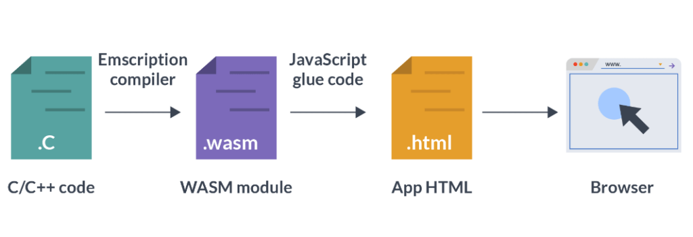

TL;DR: WebAssembly (WASM) lets code written in languages such as Rust, C++, R and Python run in the browser at near-native speed. With tools like shinylive, PyShiny, Quarto, Trinket, webr and Pyodide, developers can build interactive applications that do not always need a backend server.

## WebAssembly: A True Web Revolution



WebAssembly, or WASM, represents a paradigm shift in web development. As a low-level, binary instruction format designed to run on modern web browsers, WebAssembly enables developers to build web applications with near-native performance. This technology has ushered in a new era where web applications are not only faster but also more versatile, supporting languages beyond JavaScript, such as Rust, C++, R, and Python.

The most striking feature of WebAssembly is its ability to eliminate the traditional barriers to high-performance computing on the web. By compiling code written in various languages into a compact binary format, WebAssembly ensures that applications can execute efficiently, rivaling desktop applications in performance. This capability extends to interactive and computationally heavy applications, such as gaming, data visualization, and machine learning.

**WebAssembly** makes it possible to develop powerful tools such as **Pyodide** and **webr**, which serve as foundational building blocks for higher-level frameworks. By compiling entire language runtimes (Python for Pyodide and R for webr) into WebAssembly, these projects allow code to run directly in the browser without a server. The key to their performance is WebAssembly's standardized, low-level bytecode, which modern browsers can execute at near-native speeds. This enables client-side execution of Python or R, including extensive libraries, and supports rich, interactive web applications without a specialized backend.

A critical step between a language's source code (Python or R) and the final WebAssembly binary is **LLVM**, a specialized compiler infrastructure. For instance, **Emscripten** (an LLVM-based toolchain) compiles C and C++ to WebAssembly. Pyodide follows a similar approach by compiling Python's C-based runtime into WebAssembly, and webr does the same for R. By leveraging this workflow, developers can integrate Python or R code, along with their libraries, directly with JavaScript in the browser. This opens up new possibilities for in-browser data analysis, visualization, and education.

Here is a simple example of R code running via webr:

```{webr-r}
print("Hello world!")
```

Below is Python code running through Pyodide:

```{pyodide-python}
import this
```

In short, WebAssembly, LLVM and toolchains such as Pyodide and webr make the browser a practical place for client-side computing.

### shinylive

For example, shinylive is available in two versions: one for PyShiny (Python) built on Pyodide, and another for Shiny (R) powered by webr. Both versions allow developers to create dynamic dashboards that run entirely in the browser, removing the need for backend servers and significantly simplifying deployment while reducing costs. A practical example is a real-time data visualization tool built with shinylive, which can instantly reflect updates to the underlying data.

python shinylive (shiny.express):

```{shinylive-python}
#| standalone: true
#| components: [editor, viewer]
#| layout: vertical
#| viewerHeight: 350

import matplotlib.pyplot as plt
import numpy as np
from shiny.express import ui, input, render

with ui.sidebar():
    ui.input_slider("n", "N", 0, 100, 20)

@render.plot(alt="A histogram", height=300)
def histogram():
    np.random.seed(1234)
    x = 100 + 15 * np.random.randn(437)
    plt.hist(x, input.n())
```

### Trinket

**Trinket**, a platform for interactive coding, uses WebAssembly to let educators and learners run Python, HTML and JavaScript snippets directly in the browser. This removes the need for local installation. 
  
For an example in action, visit the [Python for Everybody Book](https://books.trinket.io/pfe/index.html), where Trinket facilitates hands-on coding exercises right in the browser.

### Many more examples

There are many more examples of how Webassembly is changing the Internet.  
Please leave the ones you think should be discussed here as a comment.

## Bridging the Gap Between Development and Deployment

WebAssembly is useful because it can move work that normally needs a server into the user's browser. That can reduce hosting complexity and make small interactive tools easier to share.

## The Future of Web Development

WebAssembly is more than just a tool for optimization; it is the foundation for a new generation of web applications. Its impact spans industries, enabling high-performance applications in gaming, scientific computing, and even augmented reality. As more frameworks and libraries integrate with WebAssembly, the ecosystem continues to grow, paving the way for innovative applications that were previously impractical for the web.

## Conclusion

WebAssembly is useful because it moves serious computation into the browser. For data science, education and lightweight applications, tools like webr, Pyodide and shinylive make it possible to share interactive work without running a dedicated server.

## References

1. **WebAssembly**  
   - Official Website: [https://webassembly.org](https://webassembly.org)  
   - GitHub Repository: [https://github.com/WebAssembly](https://github.com/WebAssembly)  
   - Developer Guide: [MDN Web Docs on WebAssembly](https://developer.mozilla.org/en-US/docs/WebAssembly)

2. **WebR**  
   - Official GitHub Repository: [https://github.com/r-wasm/webr](https://github.com/r-wasm/webr)  
   - Documentation and Examples: [https://webr.r-wasm.org](https://webr.r-wasm.org)

3. **Pyodide**  
   - Official Website: [https://pyodide.org](https://pyodide.org)  
   - GitHub Repository: [https://github.com/pyodide/pyodide](https://github.com/pyodide/pyodide)  
   - Documentation: [https://pyodide.org/en/stable/](https://pyodide.org/en/stable/)

4. **Shiny Live**  
   - Official Documentation: [https://shiny.rstudio.com/articles/shinylive.html](https://shiny.rstudio.com/articles/shinylive.html)  
   - GitHub Repository: [https://github.com/rstudio/shinylive](https://github.com/rstudio/shinylive)
