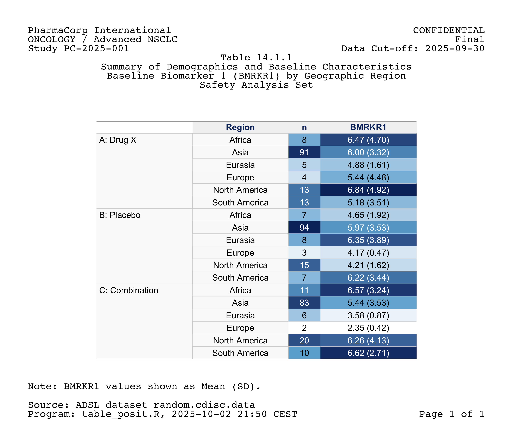

My entry in the **2025 Posit Table Contest** was recognised as **The Best Pharma Table** in [Posit's official results](https://posit.co/blog/2025-table-contest-winners/).

The project combines **gt** for table styling with **gridify** for page layout. It demonstrates how a statistical summary, report metadata and presentation can be assembled in one R workflow.

## What it demonstrates

- Summarising a synthetic baseline dataset by treatment arm and geographic region.
- Styling counts and biomarker summaries with **gt**.
- Using **gridify** to position study information, titles, population labels, footnotes and page metadata around the table.
- Exporting the result as PNG and PDF.

All data, company names and study details in the example are synthetic. This is a reporting demonstration, not a real regulatory submission.

## The table

{fig-alt="A baseline characteristics table grouped by treatment arm and region, with report headers, titles and footnotes."}

## Explore the project

- [GitHub repository](https://github.com/Polkas/tgcontest2025)
- [R source code](https://github.com/Polkas/tgcontest2025/blob/main/table_posit.r)
- [PDF output](https://github.com/Polkas/tgcontest2025/blob/main/polkas_table_contest_2025.pdf)
- [gridify framework](https://github.com/pharmaverse/gridify)
